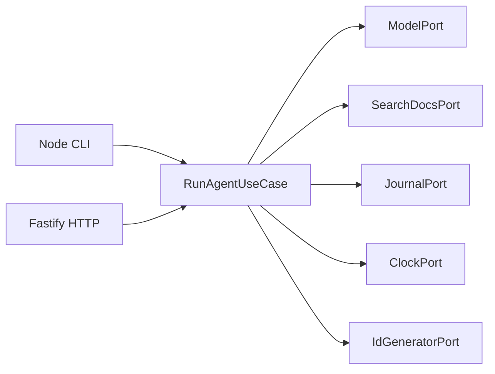

# Iteration 1 — Typed Agent Loop

This iteration runs one documentation assistant through a Node CLI and a Fastify HTTP endpoint. Both invoke the same application use case and a local deterministic teaching model. Each successful run performs two model requests, one search_docs call, and eight awaited journal appends.

The model follows a fixed script and returns a fixed teaching answer. It requests lexical search using the question and selects up to two returned document IDs for the final result. This makes execution reproducible and gives the course an explicit model port to replace in a later iteration.

## Run the walkthrough

Use Node.js 24 and run these commands from the repository root. Dependency installation requires registry access. The installed application and tests operate locally, including HTTP tests that connect to an ephemeral port on 127.0.0.1.

```powershell
node --version
npm ci
npm run build
npm run uaos -- ask "execution journal"
npm run validate
```

On this Windows checkout the bundled Node.js 24 runtime can be selected explicitly for validation.

```powershell
$node24 = Join-Path $env:USERPROFILE '.cache/codex-runtimes/codex-primary-runtime/dependencies/node/bin/node.exe'
$env:Path = (Split-Path $node24) + ';' + $env:Path
& $node24 "$env:ProgramFiles/nodejs/node_modules/npm/bin/npm-cli.js" run validate
```

The CLI prints the answer, document source references, usage counters, and a generated run ID. Success exits with code 0. Invalid arguments, invalid questions, and typed run failures exit with code 1. SIGINT cancels the active run and the CLI removes its signal listener in finally.

Start HTTP in a second terminal from the same repository root.

```powershell
node --input-type=module -e "import { startServer } from './dist/src/composition/server.js'; await startServer();"
```

Submit the same question and inspect its journal.

```powershell
$result = Invoke-RestMethod -Method Post -Uri 'http://127.0.0.1:3000/api/v1/agent-runs' -ContentType 'application/json' -Body '{"question":"execution journal"}'
$result
$result.usage
Get-Content -LiteralPath (Join-Path '.uaos/journal' ($result.runId + '.jsonl'))
```

CLI and HTTP return the same logical answer, sources, and usage with independent generated run IDs. The expected answer is `The typed agent loop records ordered execution evidence around model and search actions.` Usage is modelCalls 2 and toolCalls 1. A query with no matching terms still returns a valid empty search result and no source references. The teaching answer remains fixed.

startServer accepts optional host, port, fixtureRoot, and journalRoot settings. Defaults are 127.0.0.1, port 3000, fixtures/docs, and .uaos/journal. The CLI also supports the operator-controlled UAOS_FIXTURE_ROOT and UAOS_JOURNAL_ROOT environment variables.

## Follow the execution



The domain owns strict Zod schemas and inferred types. The application owns validation, state transitions, budgets, cancellation, failure normalization, and evidence ordering. Adapters own Markdown files, model behavior, JSONL, processes, and HTTP. createRuntime wires the default adapters. Core compilation and dependency tests enforce this direction.

| State | Accepted action | Next outcome |
|---|---|---|
| awaiting_tool | call_tool with literal toolName search_docs and valid arguments | Persist the request, execute search, persist the observation, enter awaiting_final |
| awaiting_final | final_answer with sourceIds returned by search | Persist run.succeeded and return the answer |

A final answer before search, another tool call, or an invented source ID fails with INVALID_TRANSITION. The application validates unknown public input, model actions, tool observations, events, and final results. Invalid model arguments are rejected before the search effect.

search_docs accepts a trimmed nonempty query and optional integer limit from 1 to 5, defaulting to 3. The adapter loads a controlled Markdown fixture set once, normalizes Unicode terms, ranks by matched-term count, and breaks ties by documentId. Returned IDs identify documents. Passage-level grounding and citation validation arrive in Phase 4.

## Inspect safe evidence

A successful JSONL file contains this event order.

```text
run.started
model.requested
model.responded
tool.requested
tool.succeeded
model.requested
model.responded
run.succeeded
```

Each line has schemaVersion 1.0, eventId, runId, sequence, occurredAt, eventType, and a strict payload. The journal includes identifiers, sequence, counts, action kinds, durations, source IDs, answer length, and normalized error metadata as applicable. Questions, document bodies, excerpts, complete answers, raw provider data, and exception details are excluded.

Every append is awaited and synced before later effects. A failed append returns JOURNAL_FAILURE and stops further model/tool work. A writable failed run has one run.failed or run.cancelled terminal. A broken journal may contain an incomplete prefix and no terminal. Each generated run ID selects its own filename under a trusted configured root.

## Diagnose failures

| Code | Trigger | HTTP status |
|---|---|---|
| INVALID_REQUEST | Public input fails strict validation | 400 |
| MODEL_FAILURE | Model adapter fails | 502 |
| INVALID_MODEL_ACTION | Model output fails its schema | 422 |
| INVALID_TRANSITION | Action or source membership violates the state contract | 422 |
| TOOL_FAILURE | Search or observation validation fails | 502 |
| TIMEOUT | Overall deadline wins | 408 |
| CANCELLED | Caller cancellation wins | 499 |
| LIMIT_EXCEEDED | Another call exceeds policy | 422 |
| JOURNAL_FAILURE | Required evidence append fails | 500 |
| INTERNAL_ERROR | Unexpected orchestration failure is normalized | 500 |

The use case creates runId before semantic validation. HTTP malformed JSON, unsupported content types, and bodies larger than 16384 bytes are rejected at the transport boundary with sanitized 400, 415, and 413 responses.

The default deadline is 5000 ms with budgets of two model calls and one tool call. The first tagged cancellation origin determines TIMEOUT or CANCELLED. Ports must honor AbortSignal. Terminal evidence after cancellation uses an independent cleanup signal bounded to 250 ms.

HTTP body completion leaves the run active. Closing an unfinished response cancels it. A client that has disconnected cannot receive the cancellation response, so inspect its journal for run.cancelled. Concurrent requests keep signals, counters, IDs, and files isolated.

## Review and learning exercises

Run the focused suites to explore each boundary.

```powershell
npm test -- tests/contracts/schemas.test.ts tests/contracts/agent-events.test.ts
npm test -- tests/unit/run-agent-failures.test.ts
npm test -- tests/integration/http.test.ts tests/integration/jsonl-journal.test.ts
npm test -- tests/smoke/cli.test.ts
```

Explain why a second tool request cannot run, how a failed journal prevents a later effect, which terminal event survives cancellation, and how HTTP distinguishes completed request input from a disconnected client. Reproduce each answer with the corresponding test.

The initial telemetry duration fields are zero-valued teaching metadata. The trusted filesystem roots and cooperative port cancellation are operational assumptions. Production deployment, model quality evaluation, durable memory, MCP, UI, and multi-agent behavior are deferred by the roadmap.

Implementation and automated verification are complete. The contract architecture review from 2026-09-30 remains recorded. Implementation review, explicit phase approval, and stability are pending in the [iteration evidence](../reviews/ITERATION-01-evidence.md). See the [architecture decision](../architecture/decisions/ADR-0003-typed-agent-loop-contracts.md) for the full contracts.
